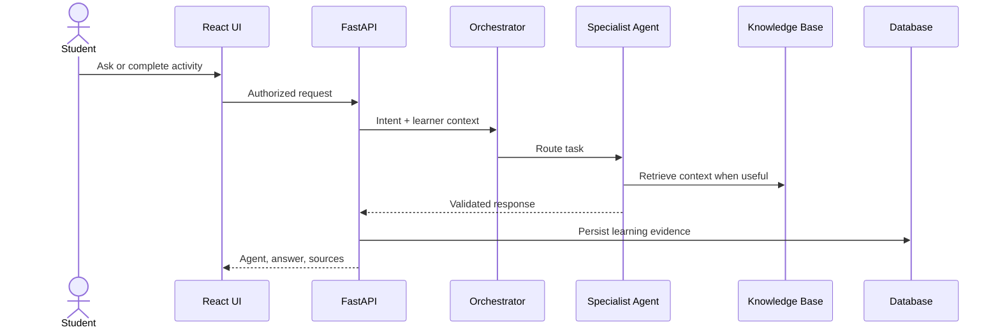

# Architecture

Mentora uses a single React client, a FastAPI application, and one relational database. This keeps the college MVP understandable and deployable while preserving clear boundaries for AI providers and retrieval.

All persisted queries include the authenticated user ID. The deterministic demo provider makes the core journey testable without external credentials. A production provider should return Pydantic-validated structured output, retry once on malformed output, and fail safely.

