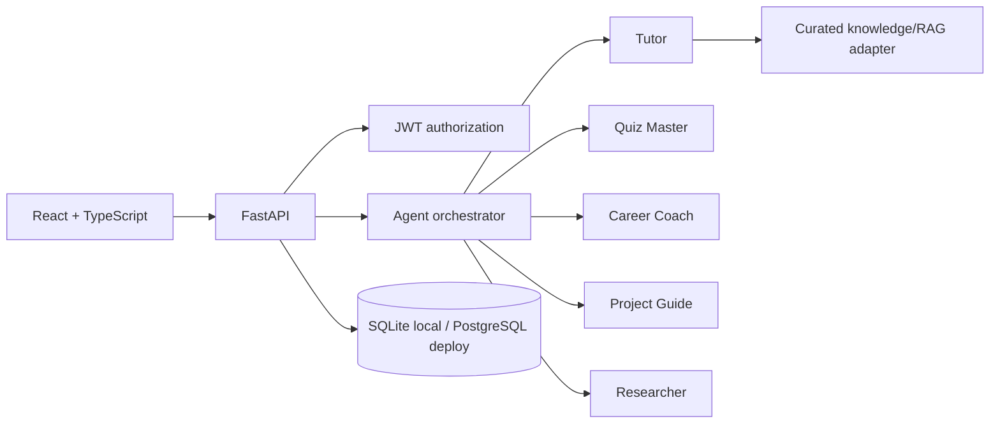

# Mentora AI

Mentora AI is an agentic, personalized learning and career-guidance MVP. It assesses a learner, creates a roadmap, teaches through a routed AI mentor, adapts to quiz performance, recommends career skills and projects, and tracks progress.

## Features

- JWT registration/login with user-scoped data
- Student onboarding, current skills, career goal and study-time profile
- Scored initial assessment with weak-topic detection
- Persisted adaptive quizzes with difficulty progression and answer explanations
- Persisted personalized roadmap
- Prerequisite-ordered AI Engineer roadmap with validated foundations shown as completed
- Visible multi-agent routing: Tutor, Quiz Master, Career Coach, Project Guide and Researcher
- Grounded local knowledge responses with source labels
- Career skill-gap analysis and project recommendations
- Research updates, progress, streak and in-app reminders
- Responsive React interface and seeded demo account

## Architecture



The no-key mode uses deterministic agent responses with local ChromaDB retrieval, so the complete learning journey remains available offline. Set `AI_PROVIDER=openai` and supply an API key to use the live provider without changing the UI or database.

## Run locally

### Backend

```powershell
cd backend
python -m venv .venv
.venv\Scripts\Activate.ps1
pip install -r requirements.txt
python -m alembic -c alembic.ini upgrade head
python scripts/ingest_knowledge.py
uvicorn app.main:app --reload
```

API docs: `http://localhost:8000/docs`

### Frontend

```powershell
cd frontend
npm install
npm run dev
```

Open `http://localhost:5173`.

## Demo credentials

- Email: `demo@mentora.ai`
- Password: `MentoraDemo123!`

## Environment

Copy `.env.example` to `.env`. Replace `JWT_SECRET` outside local development. `DATABASE_URL` defaults to SQLite; use a PostgreSQL SQLAlchemy URL for deployment. Keep `AI_PROVIDER=demo` for offline operation or set it to `openai` with `OPENAI_API_KEY`. `VITE_API_URL` may be set in `frontend/.env` when the API is not at `http://localhost:8000`.

## Tests and build

```powershell
cd backend
pytest -q

cd ..\frontend
npm test
npm run lint
npm run build
```

## Deployment

Deploy `frontend` to a static Vite host such as Vercel and `backend` to a Python host such as Render. Set `VITE_API_URL`, `DATABASE_URL`, `JWT_SECRET`, and the production CORS origin. Use PostgreSQL for durable production storage.

## Limitations

- Roadmap, career and quiz personalization remain deterministic and auditable; they do not require an LLM.
- The MVP uses a compact local corpus and deterministic embeddings in persistent ChromaDB; production semantic embeddings are not configured by default.
- Research updates are curated demo records; no uncontrolled crawler is enabled.
- Email, WhatsApp, mobile, LMS, marketplace and payment features are future work.

## Project documentation

Evaluators should begin with `SUBMISSION_GUIDE.md`. Additional references include `PROJECT_OVERVIEW.md`, `FEATURES.md`, `SETUP.md`, `ARCHITECTURE.md`, `AGENTS.md`, `API.md`, `DATABASE.md`, `RAG.md`, `TESTING.md`, `DEPLOYMENT.md`, `DEMO_GUIDE.md`, `FUTURE_ENHANCEMENTS.md`, and `PROCESS.md`.
